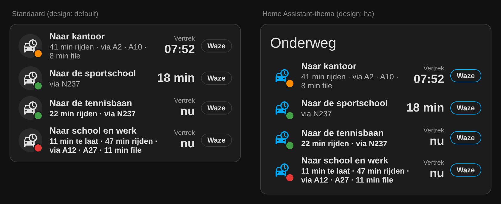

<p align="center">
  
</p>

# Commute Time

**Hoe lang rijd ik erover, en hoe laat moet ik weg?** Commute Time zet per vaste route de reistijd met verkeer, de wegen en de files op je Home Assistant-dashboard, en rekent uit wanneer je moet vertrekken om op tijd te zijn.

[](https://github.com/vossov/commute-time/releases) [](https://hacs.xyz) [](https://www.home-assistant.io) [](https://github.com/vossov/commute-time/blob/main/LICENSE)

[](https://my.home-assistant.io/redirect/hacs_repository/?owner=vossov&repository=commute-time&category=integration)

<p align="center">
  
  <br>
  <sub>De kaart in de Bubble-stijl. Voorbeeldgegevens, in een browser getekend: geen schermafbeelding uit Home Assistant.</sub>
</p>

## Inhoud

**[`Wat je krijgt`](#wat-je-krijgt)**  **[`Installeren`](#installeren)**  **[`Een route instellen`](#een-route-instellen)**  **[`De kaart`](#de-kaart)**  **[`Sensoren`](#sensoren)**  **[`Goed om te weten`](#goed-om-te-weten)**  **[`Veelgestelde vragen`](#veelgestelde-vragen)**  **[`Versies en hulp`](#versies-en-hulp)**

## Wat je krijgt

- **Vertrektijd of rijtijd, bovenaan de kaart.** Met een aankomsttijd staat er *Vertrek 07:52*, zonder aankomsttijd *34 min*. Eronder de wegen en de files.
- **Per route een eigen startadres**, tot drie tussenstops en een bestemming. Begin en eind mogen een adres zijn, een coördinaat, of een entiteit: `zone.home`, of `person.naam` om te vertrekken vanaf waar iemand nu is.
- **Een rooster per weekdag.** Je zegt wanneer de route in beeld is en, als je dat wilt, hoe laat je er wilt zijn. Buiten dat venster wordt er niets opgevraagd.
- **Een kaart in drie vormgevingen**, waaronder een Bubble Card-stijl, met een visuele editor. Een tik opent de details: andere routes, etappes en de files.
- **Een knop om Waze te openen** met je bestemming, om te gaan rijden.

## Installeren

**Via HACS** (aanbevolen): klik op de knop bovenaan, of ga in HACS naar ⋮ → *Aangepaste repositories* en voeg `https://github.com/vossov/commute-time` toe als categorie **Integratie**. Download *Commute Time* en herstart Home Assistant.

<details>

<summary>Zonder HACS</summary>

<br>

Kopieer de map `custom_components/commute_time` naar `config/custom_components/` en herstart Home Assistant.

</details>

De kaart hoort bij de integratie en wordt vanzelf geladen. Je hoeft geen resources toe te voegen, en Bubble Card of button-card is niet nodig. Na een update kan het nodig zijn de pagina te verversen.

**Je hebt een gratis TomTom-sleutel nodig.** De integratie haalt routes en adressen bij TomTom op. [Hoe je die aanmaakt, en wat je erbij moet aanzetten](https://github.com/vossov/commute-time/blob/main/docs/tomtom-sleutel.md).

## Een route instellen

[](https://my.home-assistant.io/redirect/config_flow_start/?domain=commute_time)

*Instellingen → Apparaten & Services → Integratie toevoegen → Commute Time.* Je voegt **één route per keer** toe; voor een tweede route voeg je de integratie nog eens toe. De sleutel staat dan al ingevuld.

1. **Route**: naam, sleutel, vertrekpunt, tussenstops (één per regel, hoogstens drie) en bestemming.
2. **Bevestigen**: TomTom laat zien welke adressen hij vond, plus de reistijd van nu. Klopt een adres niet, breek dan af en typ het preciezer. "Stationsstraat 1" ligt in tientallen plaatsen.

Daarna, onder **Configureren**:

| instelling | standaard | wat het doet |
|---|---|---|
| Marge | 5 min | zoveel eerder dan de aankomsttijd wil je er zijn |
| Stoptijd per tussenstop | 0 min | hoe lang je bij elke stop stilstaat; het vertrek schuift zoveel naar voren |
| Vervoer | auto | auto of motor |
| Vermijden | niets | tolwegen, snelwegen, veerboten, onverharde wegen. Een voorkeur, geen verbod |
| Andere routes tonen | 2 | hoeveel alternatieven in het detailvenster staan |
| Verversen elke | 5 min | alleen binnen het venster |

Op de tweede pagina staat het **rooster**: per weekdag *tonen vanaf*, *tonen tot* en *aankomen om*. Standaard maandag tot en met vrijdag van 06:30 tot 09:30, zonder aankomsttijd.

**De aankomsttijd is optioneel**, per dag. Vul je hem in, dan rekent TomTom terug en is de vertrektijd het hoofdgetal. Laat je hem leeg (het tijdveld heeft een wis-knop), dan toont de kaart de rijtijd.

## De kaart

```yaml
type: custom:commute-time-card
entities:
  - sensor.naar_werk_reistijd
  - sensor.naar_school_reistijd
design: bubble
```

Alles is ook in de visuele editor in te stellen.

### Opties van de kaart

| optie | standaard | wat het doet |
|---|---|---|
| `entities` | — | de reistijd-sensoren van je routes, in volgorde |
| `title` | leeg | een kop boven de kaart |
| `design` | `default` | `default` (eigen opmaak), `ha` (volgt je Home Assistant-thema) of `bubble` (in de stijl van Bubble Card, zonder die kaart nodig te hebben) |
| `show` | `window` | `window`: een route staat er alleen binnen zijn venster, en zonder route in beeld verbergt de kaart zich. `always`: altijd, met buiten het venster wanneer hij terugkomt |
| `target` | `false` | toont ook de aankomsttijd en marge die je zelf hebt ingevoerd ("voor 08:30, 5 min marge"), onder de naam en in het venster |
| `details` | `true` | een tik opent het detailvenster |
| `waze` | `true` | een knop om Waze te openen met de bestemming |

**Wat er op de kaart staat**

- **Rechts**: met een aankomsttijd de vertrektijd (*Vertrek 07:52*, of *Vertrek nu* als het zover is), zonder aankomsttijd de rijtijd (*34 min*).
- **Onder de naam**: hoe lang je rijdt, de wegen en de minuten file. Kom je te laat, dan staat daar *11 min te laat*. De kleur van het icoon (bij `bubble`) of het stipje (bij de andere twee) is groen, oranje of rood naar de vertraging die TomTom meldt.
- **In het venster**: de reistijd nu, gebruikelijk op dit uur en zonder verkeer; wat er bij je vertrektijd verwacht wordt; de files met weg, snelheid en vertraging; de etappes langs je tussenstops; andere routes; en de adressen zoals ze gevonden zijn.

Een sensor die er niet is of niet werkt, blijft in beeld met een melding. Verbergen zou juist het probleem verbergen.

<p align="center">
  
  <br>
  <sub>Het detailvenster, met voorbeeldgegevens.</sub>
</p>

<details>

<summary>De andere twee vormgevingen</summary>

<br>

<p align="center">
  
</p>

</details>

<details>

<summary>Hoe de Bubble-stijl is opgebouwd</summary>

<br>

De Bubble-stijl is nagebouwd naar de echte Bubble Card, nagelezen in `dist/bubble-card.js` van [Clooos/Bubble-Card](https://github.com/Clooos/Bubble-Card): een pil in de secundaire achtergrondkleur met het icoon in een rondje in de kaartachtergrond, 50 px hoog, de naam 13 px vet en de status 12 px, de waarden als pillen van 36 px, en een pop-up die onderaan het scherm plakt. Ze gebruikt dezelfde terugvalketens, dus stelt je thema `--bubble-main-background-color`, `--bubble-border-radius` en dergelijke in, dan volgt de kaart die. Dat laatste is uit de broncode afgeleid en niet met een Bubble-thema geprobeerd.

</details>

## Sensoren

Per route twee, onder een apparaat met de naam van de route:

| sensor | waarde |
|---|---|
| `sensor.<route>_reistijd` | minuten rijden als je nu vertrekt. Buiten het venster en bij een fout: onbekend. Met langetermijnstatistiek |
| `sensor.<route>_vertrektijd` | het tijdstip waarop je moet vertrekken; alleen als er vandaag een aankomsttijd is |

In een Engelstalige Home Assistant heten ze `_travel_time` en `_departure_time`. De attributen van de reistijd zijn wat de kaart leest; ze gaan niet naar de recorder, de reistijd zelf wel.

<details>

<summary>Voorbeeld: een melding tien minuten vóór vertrek</summary>

<br>

```yaml
alias: Bijna tijd om naar werk te gaan
triggers:
  - trigger: template
    value_template: >
      
      {{ v not in ['unknown', 'unavailable']
         and now() >= as_datetime(v) - timedelta(minutes=10) }}
actions:
  - action: notify.mobile_app_telefoon
    data:
      message: >
        Over 10 minuten vertrekken naar werk
        ({{ states('sensor.naar_werk_reistijd') }} min rijden).
```

</details>

## Goed om te weten

- **Reistijd en vertrektijd zijn schattingen van TomTom**, geen metingen. De vertrektijd wordt elke ronde opnieuw berekend, dus hij leunt op steeds actueler verkeer naarmate je vertrek nadert. De documentatie van TomTom zegt niet hoe zwaar live verkeer meeweegt voor een moment dat nog moet komen.
- **Afronding gaat de veilige kant op**: een vertrektijd van 07:52:40 wordt 07:52, en 10 minuten en 20 seconden te laat wordt 11.
- **Waze rekent zelf.** De knop geeft Waze alleen de bestemming; Waze kiest zijn eigen route, die kan afwijken van wat TomTom toont.
- **De tests draaien op voorbeelden uit TomTom's documentatie**, niet op een antwoord met een echte sleutel, en dekken het scherm in een draaiende Home Assistant niet.

[Alles over nauwkeurigheid, kosten, privacy en wat niet getest is](https://github.com/vossov/commute-time/blob/main/docs/betrouwbaarheid.md)

## Veelgestelde vragen

<details>

<summary>Heette dit eerst Time to Leave?</summary>

<br>

Ja, tot versie 0.2.1. Die naam was al in gebruik door een andere app. Overstappen van Time to Leave vraagt één keer je routes opnieuw toevoegen; [de stappen staan bij versie 0.3.0](https://github.com/vossov/commute-time/blob/main/CHANGELOG.md).

</details>

<details>

<summary>Waarom TomTom en niet Waze?</summary>

<br>

Waze heeft geen openbare routing-API, en de voorwaarden van Waze verbieden geautomatiseerde toegang en het omzeilen van beveiliging. TomTom heeft wel een officiële API met een gratis sleutel, en kan zelf terugrekenen vanaf een aankomsttijd. Waze blijft in beeld voor het rijden zelf, via de officiële Waze-link. [De hele afweging, met bronnen](https://github.com/vossov/commute-time/blob/main/docs/waarom-tomtom.md).

</details>

<details>

<summary>Gaat er iets naar TomTom als de route niet in beeld is?</summary>

<br>

Nee. Buiten het venster wordt de integratie hooguit eens per uur wakker om te kijken of het venster begint, zonder verzoek. Dat is gemeten met een simulatie van een hele dag, en die simulatie is een test. Alleen een route toevoegen of de adressen wijzigen controleert meteen bij TomTom.

</details>

<details>

<summary>Wat kost het?</summary>

<br>

Het gratis plan van TomTom geeft 2.500 verzoeken per dag. Een route met een venster van 06:30 tot 09:30, elke 5 minuten en een aankomsttijd van 08:30 kost er 60 per dag, hoogstens 73. Drie routes blijven dus ruim eronder. [De berekening](https://github.com/vossov/commute-time/blob/main/docs/betrouwbaarheid.md#wat-het-kost).

</details>

<details>

<summary>Wat gebeurt er met mijn adressen en mijn sleutel?</summary>

<br>

Je adressen gaan naar TomTom, om op te zoeken en om de route te berekenen. Wat TomTom vindt wordt niet op schijf bewaard, alleen in het geheugen tot middernacht. De sleutel staat onversleuteld in de opslag van Home Assistant, zoals bij elke integratie, en dus ook in je back-ups; hij staat niet in de attributen, de kaart of het logboek. [Meer over privacy](https://github.com/vossov/commute-time/blob/main/docs/betrouwbaarheid.md#privacy-en-opslag).

</details>

<details>

<summary>Welke rechten moet mijn TomTom-sleutel hebben?</summary>

<br>

Dat minimum is nog niet vastgesteld: de eerste proef met alleen de Routing API en de Search API was te weinig. [Wat wel bekend is, en hoe je het minimum zelf vindt](https://github.com/vossov/commute-time/blob/main/docs/tomtom-sleutel.md).

</details>

## Versies en hulp

- **[Alle versies en wat er veranderd is](https://github.com/vossov/commute-time/blob/main/CHANGELOG.md)**. Elke versie krijgt vanzelf een release met die notes.
- **Iets stuk, of een wens?** Maak een [issue](https://github.com/vossov/commute-time/issues) aan. Staat er een melding in de kaart, vermeld die dan, want op een telefoon is er geen logboek.
- **Licentie**: [MIT](https://github.com/vossov/commute-time/blob/main/LICENSE).
