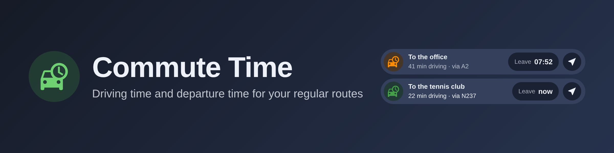
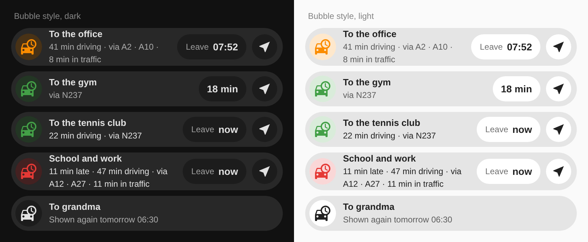
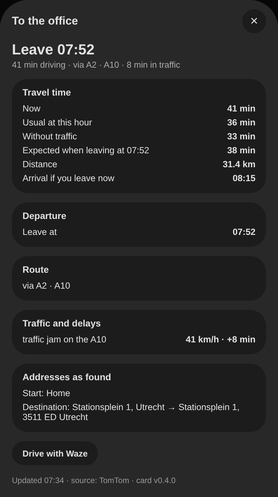

<p align="center">
  
</p>

# Commute Time

**How long will the drive take, and when do I have to leave?** Commute Time puts the travel time with traffic, the roads and the traffic jams of each of your regular routes on your Home Assistant dashboard, and works out when you have to leave to arrive on time.

[](https://github.com/vossov/commute-time/releases) [](https://hacs.xyz) [](https://www.home-assistant.io) [](https://github.com/vossov/commute-time/blob/main/LICENSE)

[](https://my.home-assistant.io/redirect/hacs_repository/?owner=vossov&repository=commute-time&category=integration)

<p align="center">
  
  <br>
  <sub>The card in the Bubble style. Sample data, rendered in a browser: not a screenshot from Home Assistant.</sub>
</p>

## Contents

**[`What you get`](#what-you-get)**  **[`Installation`](#installation)**  **[`Setting up a route`](#setting-up-a-route)**  **[`The card`](#the-card)**  **[`Sensors`](#sensors)**  **[`Good to know`](#good-to-know)**  **[`FAQ`](#faq)**  **[`Versions and help`](#versions-and-help)**

## What you get

- **Departure time or driving time, at the top of the card.** With an arrival time it says *Leave 07:52*, without one *34 min*. Below it the roads and the traffic.
- **A start address per route**, up to three stops on the way, and a destination. Start and end can be an address, a coordinate, or an entity: `zone.home`, or `person.name` to leave from wherever someone is right now.
- **A schedule per weekday.** You say when the route is shown and, if you like, what time you want to arrive. Outside that window nothing is requested.
- **A card in three designs**, including a Bubble Card style, with a visual editor and a choice of English or Dutch. A tap opens the details: other routes, legs and the traffic.
- **A button to open Waze** with your destination, to start driving.

## Installation

**With HACS** (recommended): click the button at the top, or in HACS go to ⋮ → *Custom repositories* and add `https://github.com/vossov/commute-time` with the category **Integration**. Download *Commute Time* and restart Home Assistant.

<details>

<summary>Without HACS</summary>

<br>

Copy the folder `custom_components/commute_time` to `config/custom_components/` and restart Home Assistant.

</details>

The card comes with the integration and loads by itself. You do not have to add resources, and you do not need Bubble Card or button-card. After an update you may have to refresh the page.

**You need a free TomTom key.** The integration gets routes and addresses from TomTom. [How to create one, and what to enable](https://github.com/vossov/commute-time/blob/main/docs/tomtom-key.md).

## Setting up a route

[](https://my.home-assistant.io/redirect/config_flow_start/?domain=commute_time)

*Settings → Devices & services → Add integration → Commute Time.* You add **one route at a time**; for a second route you add the integration again. The key is then already filled in.

1. **Route**: name, key, starting point, stops on the way (one per line, at most three) and destination.
2. **Confirm**: TomTom shows which addresses it found, plus the travel time right now. If an address is wrong, cancel and type it more precisely. "Station Road 1" exists in dozens of towns.

Then, under **Configure**:

| setting | default | what it does |
|---|---|---|
| Margin | 5 min | how much earlier than the arrival time you want to be there |
| Time per stop | 0 min | how long you stand still at each stop; the departure moves that much earlier |
| Vehicle | car | car or motorcycle |
| Avoid | nothing | toll roads, motorways, ferries, unpaved roads. A preference, not a ban |
| Other routes to show | 2 | how many alternatives the detail view lists |
| Refresh every | 5 min | only inside the window |

The second page holds the **schedule**: for each weekday *show from*, *show until* and *arrive at*. By default Monday to Friday from 06:30 to 09:30, without an arrival time.

**The arrival time is optional**, per day. If you fill it in, TomTom works backwards and the departure time becomes the main number. If you leave it empty (the time field has a clear button), the card shows the driving time.

## The card

```yaml
type: custom:commute-time-card
entities:
  - sensor.to_work_travel_time
  - sensor.to_school_travel_time
design: bubble
```

Everything can also be set in the visual editor.

### Card options

| option | default | what it does |
|---|---|---|
| `entities` | — | the travel time sensors of your routes, in order |
| `title` | empty | a title above the card |
| `design` | `default` | `default` (own style), `ha` (follows your Home Assistant theme) or `bubble` (in the style of Bubble Card, without needing that card) |
| `show` | `window` | `window`: a route is only shown inside its window, and with no route to show the card hides itself. `always`: always, and outside the window it says when the route comes back |
| `target` | `false` | also shows the arrival time and margin you entered yourself ("by 08:30, 5 min margin"), under the name and in the detail view |
| `details` | `true` | a tap opens the detail view |
| `waze` | `true` | a button that opens Waze with the destination |
| `language` | `en` | `en` (English) or `nl` (Dutch): the language of the card and its editor |

**What the card shows**

- **On the right**: with an arrival time the departure time (*Leave 07:52*, or *Leave now* when it is time), without an arrival time the driving time (*34 min*).
- **Under the name**: how long you drive, the roads and the minutes in traffic. If you will be late, it says *11 min late*. The colour of the icon (with `bubble`) or the dot (with the other two) is green, orange or red, depending on the delay TomTom reports.
- **In the detail view**: the travel time now, as usual at this hour and without traffic; what is expected at your departure time; the traffic with road, speed and delay; the legs past your stops; other routes; and the addresses as they were found.

A sensor that is missing or not working stays on the card with a message. Hiding it would hide the problem.

<p align="center">
  
  <br>
  <sub>The detail view, with sample data.</sub>
</p>

<details>

<summary>The other two designs</summary>

<br>

<p align="center">
  
</p>

</details>

<details>

<summary>How the Bubble style is built</summary>

<br>

The Bubble style is modelled on the real Bubble Card, read in `dist/bubble-card.js` of [Clooos/Bubble-Card](https://github.com/Clooos/Bubble-Card): a pill in the secondary background colour with the icon in a circle in the card background, 50 px high, the name 13 px bold and the status 12 px, the values as 36 px pills, and a pop-up that sticks to the bottom of the screen. It uses the same fallback chains, so if your theme sets `--bubble-main-background-color`, `--bubble-border-radius` and the like, the card follows. That last part is derived from the source code and has not been tried with a Bubble theme.

</details>

## Sensors

Two per route, under a device named after the route:

| sensor | value |
|---|---|
| `sensor.<route>_travel_time` | minutes of driving if you leave now. Outside the window and on an error: unknown. With long-term statistics |
| `sensor.<route>_departure_time` | the moment you have to leave; only when there is an arrival time today |

In a Dutch Home Assistant they are called `_reistijd` and `_vertrektijd`. The attributes of the travel time are what the card reads; they are not recorded, the travel time itself is.

<details>

<summary>Example: a notification ten minutes before leaving</summary>

<br>

```yaml
alias: Almost time to leave for work
triggers:
  - trigger: template
    value_template: >
      
      {{ v not in ['unknown', 'unavailable']
         and now() >= as_datetime(v) - timedelta(minutes=10) }}
actions:
  - action: notify.mobile_app_phone
    data:
      message: >
        Leave for work in 10 minutes
        ({{ states('sensor.to_work_travel_time') }} min driving).
```

</details>

## Good to know

- **Travel time and departure time are TomTom's estimates**, not measurements. The departure time is recalculated every round, so it relies on ever more current traffic as your departure gets closer. TomTom's documentation does not say how much live traffic counts for a moment that is still to come.
- **Rounding goes the safe way**: a departure time of 07:52:40 becomes 07:52, and 10 minutes and 20 seconds late becomes 11.
- **Waze does its own routing.** The button only gives Waze the destination; Waze picks its own route, which can differ from what TomTom shows.
- **The tests run on examples from TomTom's documentation**, not on an answer from a real key, and do not cover the screens in a running Home Assistant.

[All about accuracy, cost, privacy and what has not been tested](https://github.com/vossov/commute-time/blob/main/docs/reliability.md)

## FAQ

<details>

<summary>Was this called Time to Leave before?</summary>

<br>

Yes, up to version 0.2.1. That name was already used by another app. Moving from Time to Leave means adding your routes once more; [the steps are under version 0.3.0](https://github.com/vossov/commute-time/blob/main/CHANGELOG.md).

</details>

<details>

<summary>Can the card be in Dutch?</summary>

<br>

Yes: set `language: nl` on the card, or pick *Nederlands* under *Language* in the editor. English is the default. The setup screens follow the language of your Home Assistant, in English or Dutch.

</details>

<details>

<summary>Why TomTom and not Waze?</summary>

<br>

Waze has no public routing API, and the Waze terms forbid automated access and getting around their protection. TomTom does have an official API with a free key, and can work backwards from an arrival time itself. Waze stays in the picture for the drive itself, through the official Waze link. [The full reasoning, with sources](https://github.com/vossov/commute-time/blob/main/docs/why-tomtom.md).

</details>

<details>

<summary>Is anything sent to TomTom while the route is not shown?</summary>

<br>

No. Outside the window the integration wakes up at most once an hour to see whether the window starts, without a request. That was measured with a simulation of a whole day, and that simulation is a test. Only adding a route or changing its addresses checks with TomTom straight away.

</details>

<details>

<summary>What does it cost?</summary>

<br>

TomTom's free plan gives 2,500 requests a day. A route with a window from 06:30 to 09:30, every 5 minutes and an arrival time of 08:30 uses 60 a day, at most 73. Three routes stay well below the limit. [The calculation](https://github.com/vossov/commute-time/blob/main/docs/reliability.md#what-it-costs).

</details>

<details>

<summary>What happens to my addresses and my key?</summary>

<br>

Your addresses go to TomTom, to look them up and to calculate the route. What TomTom finds is not stored on disk, only in memory until midnight. The key is stored unencrypted in Home Assistant's storage, like with any integration, and so also in your backups; it is not in the attributes, the card or the log. [More on privacy](https://github.com/vossov/commute-time/blob/main/docs/reliability.md#privacy-and-storage).

</details>

<details>

<summary>Which permissions does my TomTom key need?</summary>

<br>

That minimum has not been established yet: the first try with only the Routing API and the Search API was not enough. [What is known, and how to find the minimum yourself](https://github.com/vossov/commute-time/blob/main/docs/tomtom-key.md).

</details>

## Versions and help

- **[All versions and what changed](https://github.com/vossov/commute-time/blob/main/CHANGELOG.md)**. Every version gets a release with those notes automatically.
- **Something broken, or a wish?** Open an [issue](https://github.com/vossov/commute-time/issues). If the card shows a message, include it, because on a phone there is no log.
- **License**: [MIT](https://github.com/vossov/commute-time/blob/main/LICENSE).
